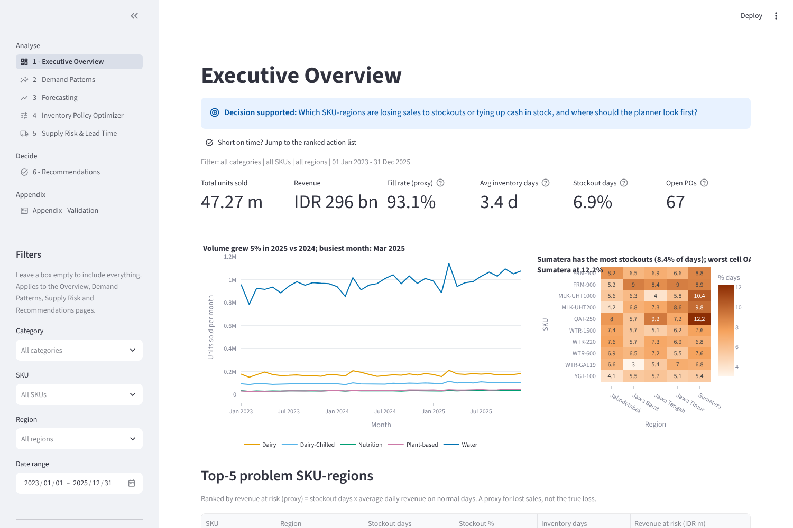
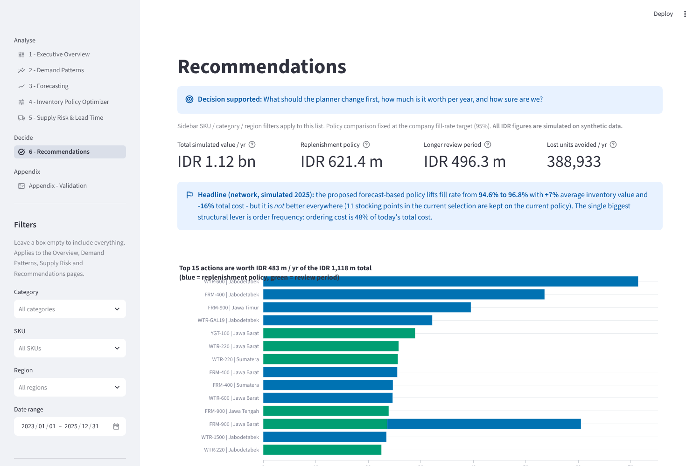

# Demand Forecasting & Inventory Optimization Dashboard

> **Synthetic data for portfolio purposes.** Every number in this repository comes from a *synthetic* dataset
> (10 generic SKUs x 5 regions, 2023-2025). It is not real company data, SKU names are generic (no real brands),
> and the "distribution centres" are fictional. All savings are **simulated**, not realised.

**Live app:** _add your Streamlit Community Cloud link here_ &nbsp;|&nbsp; **Start with:** page *6 - Recommendations*

| Executive overview | Recommendations |
|---|---|
|  |  |

More screenshots: [demand patterns](docs/screenshots/2_demand.png), [forecasting](docs/screenshots/3_forecasting.png),
[inventory optimizer](docs/screenshots/4_optimizer.png), [supply risk](docs/screenshots/5_supply.png),
[validation appendix](docs/screenshots/7_appendix.png).

---

## 1. Problem statement

A supply-chain planner of a consumer-goods company (water, UHT milk, infant nutrition, chilled yogurt, plant-based
drinks) must decide **how much to order, when, and where to hold safety stock**, while demand is shaped by payday,
Ramadan / Lebaran, promotions and weather, and replenishment lead times are long and unreliable outside Java.

The existing replenishment policy (visible in `purchase_orders.csv`) is a periodic-review, order-up-to policy driven by a
trailing 28-day average. This project asks:

1. Where do stockouts and excess stock sit today, and what drives demand?
2. Which forecasting method should drive replenishment, and how wrong will it be in event weeks?
3. What safety stock / reorder point / order quantity does each stocking point need, and what does a higher service level cost?
4. Does a forecast-based policy beat the current one **on service and cost**, and where does it not?
5. Where does unreliable supply cost money, and what should the planner do first?

Each Streamlit page states the *decision* it supports at the top.

## 2. Data disclosure and what is (not) in this repo

| File (`data_inventory/`) | Grain | Notes |
|---|---|---|
| `sales_daily.csv` | date x sku x region, 54,800 rows | `units_sold` is **censored** by stockouts |
| `sku_master.csv`, `region_master.csv` | 10 SKUs, 5 regions | costs, lead times, review periods, holding / ordering cost |
| `calendar.csv` | date | payday window, Ramadan, days to Lebaran, holidays |
| `purchase_orders.csv` | 14,714 POs | planned vs actual lead time, 67 still open |
| `ground_truth_demand.csv` | date x sku x region | true demand + lost sales. **Validation / simulation only** |

* The CSVs are committed unchanged (they are never modified by the code). The original generator script
  (`generate_inventory_dataset.py`) was **not** supplied with the project brief and is therefore not included; the committed
  CSVs are the dataset of record. If you have the generator, run it with seed 42 and it will recreate `data_inventory/`.
* The main pages work from `sales_daily.csv` + master data only. `ground_truth_demand.csv` is used in exactly two places,
  both labelled on screen: the **Validation appendix**, and as the simulated "world" in the **policy back-test** (a real
  company would have to estimate unconstrained demand).

## 3. Architecture

```
app.py                       entrypoint: page config, st.navigation, shared sidebar filters
pages/                       one file per page (UI only, <250 lines each)
  1_Executive_Overview.py    KPIs, trend, SKU x region stockout heatmap, top-5 problems, auto "So what?"
  2_Demand_Patterns.py       weekday / payday / month / Lebaran, promo event study, weather, ABC-XYZ
  3_Forecasting.py           6 models, rolling-origin back-test, WAPE/MAPE/bias/MASE, event vs normal days
  4_Inventory_Optimizer.py   SS / ROP / EOQ, cost curve, Monte-Carlo what-if, policy comparison
  5_Supply_Risk.py           lead-time reliability, disruptions, cost of unreliability, action table
  6_Recommendations.py       ranked action list (annual IDR impact, assumptions, method)
  7_Validation_Appendix.py   censoring bias and fill-rate truth vs proxy (uses ground truth)
src/
  data.py                    CSV loading (@st.cache_data), joins
  features.py                calendar / promo / temperature / lag features (all causal)
  forecasting.py             models, metrics (WAPE, MAPE, bias, MASE), rolling-origin back-test, intervals
  inventory.py               SS, ROP, EOQ, cost curve, vectorised Monte-Carlo, ABC-XYZ
  policy_backtest.py         day-by-day simulator: current vs proposed policy (50 series x 21 lead-time scenarios)
  recommendations.py         turns simulation output into a ranked action list
  analytics.py, supply.py    EDA and supply-risk analytics
  validation.py              ground-truth validation functions
  services.py                cached service layer used by the pages
  ui.py, viz.py              shared sidebar / header / footer and chart theme (colour-blind-safe Okabe-Ito palette)
scripts/compute_findings.py  recomputes every number quoted in README / FINDINGS
scripts/forecast_benchmark.py WAPE of all models on all 50 series (writes docs/forecast_benchmark.csv)
tests/                       36 unit / integration tests (formulas, metrics, ABC-XYZ, simulator invariants)
```

## 4. Methodology

**Censored demand.** `units_sold` is capped by stock. Stockout days are *excluded from training* (SARIMAX, Poisson, gradient
boosting) or imputed with the recent same-weekday level (naive, MA, ETS), and are *not scored* in the holdout because true demand
is unobservable there. A page-3 toggle shows the effect on bias; the appendix quantifies the remaining bias against the truth.

**Forecasting.** Six models on a strict time-based split (rolling origin, 4 folds, horizon 14 / 28 / 56 days, last fold =
final holdout): naive seasonal, MA28, Holt-Winters (ETS), SARIMAX with exogenous regressors (promo, post-promo, payday, Ramadan /
Lebaran bins, temperature), gradient boosting (direct multi-horizon, origin-only lag statistics) and a Poisson calendar regression.
Future temperature is replaced by a climatology learned on the training window; promos and the calendar are known in advance.
Metrics: **WAPE** (headline), MAPE (zero-guarded), bias, MASE vs in-sample seasonal naive. Intervals are out-of-sample empirical
quantiles from earlier folds. Errors are reported separately for *event days* (promo, Ramadan-Lebaran window, holidays, year end)
and normal days. A "Lebaran 2025 stress test" window puts the Lebaran peak inside the holdout.

**Inventory maths** (all unit-tested): `sigma_LT = sqrt(L*sigma_d^2 + d^2*sigma_L^2)`, `SS = z*sigma_LT`, `ROP = d*L + SS`,
`EOQ = sqrt(2DS/H)` rounded up to case-size multiples, expected shortage via the normal loss function. The cost curve adds holding,
ordering and expected stockout cost (stockout cost per unit = unit margin) and marks the optimum. The what-if simulator is a
vectorised Monte-Carlo (>= 1,000 runs, 90 days) of a periodic-review order-up-to policy with demand surge, lead-time increase and
promo shocks.

**Policy back-test (core of the project).** Both policies are simulated day by day for all 50 stocking points over 2025
against the true demand, with the same review calendar, case-size rounding and the same 21 lead-time scenarios (scenario 0 = the
real 2025 lead times, 20 = bootstrapped from observed deviations).

* *Current policy*, reverse-engineered from the 14,714 POs: order up to `0.974*MA28*T + 1.239*SD28*sqrt(T)` with `T = planned L + R + 1`
  (OLS fit; nominal 1 and z = 1.28). **Fidelity check:** replaying it with real lead times and true demand gives a stockout-day rate of
  7.15% vs 7.17% in real 2025 history and average stock within 1.2%.
* *Proposed policy*: monthly re-fitted Poisson calendar model with a 28-day level correction, protection period `observed L + R`,
  safety stock `z*d*sqrt(P*sigma_rel^2 + sigma_L^2)` with the **observed lead-time variability** and a regime-specific forecast error
  (normal / Lebaran window / promo, estimated out-of-sample), and `z` solved from a **fill-rate target** (default 95% = the company
  target in `sku_master.csv`, *not tuned on 2025*).
* KPIs: fill rate, stockout days, average inventory (units, IDR, days), and **total cost** = holding + ordering + lost margin.
  Service is never reported without cost.

## 5. Key findings (simulated, 2025 back-test; reproduce with `python scripts/compute_findings.py`)

1. **Current policy:** 94.6% fill rate with 2.9 inventory days (below the 95% target). Stockouts concentrate in Lebaran:
   **36% of 2025 lost UHT-milk units (64.7 k of 177.7 k) fall in the 12% of days between Ramadan and Lebaran + 14**.
2. **Proposed policy (95% fill target):** fill rate **+2.3 pts** (94.6% to 96.8%), average inventory **+7.0%** (IDR 840 m to 899 m),
   lost units **-42%**, total cost **-15.9%** (IDR 3.79 bn to 3.19 bn per year; range -13% to -19% across lead-time scenarios).
   Trade-off: at the *same fill rate* it needs ~10% less stock; at the *same stock* it fills +1.5 pts more. A 93% target gives +1.3 pts
   at -1.6% stock and -7% cost; 97% gives +3.3 pts at +20% stock and -25% cost (see the frontier chart on page 4).
   **It does not win everywhere:** 11 of 50 stocking points (mostly water, chilled yogurt and Jawa Tengah items, where the current policy
   already reaches 95-98% fill thanks to short lead times) are not robustly better and stay on the current policy.
3. **Lead-time variability:** Sumatera lead time is 5.6 days (std 3.3) vs 3.6 (2.3) in Jabodetabek. For the same 95% service Sumatera needs
   **+20% more safety stock** (in days of demand). In every region ~63-65% of safety stock exists only because of lead-time variability.
4. **Promotions:** +34% during the 7-day promo, then -9% for 5 days: **19% of the uplift is recovered as a dip, net uplift 16%**.
5. **Censoring:** training on stockout-censored sales under-forecasts true demand by 5.2% (Poisson) / 4.6% (MA28); excluding stockout days
   reduces that to -0.8% / -1.1% (oracle: -0.05%). The stockout-day fill-rate proxy reads 93.1% vs the true 95.3%, but ranks stocking points well (corr 0.92).
6. **Order frequency is the biggest cost block:** ordering is 48% of today's cost; the EOQ cycle is 2-4x the review period. Longer review
   periods save a further simulated IDR 496 m/yr on 28 stocking points without losing fill rate (needs real ordering-cost validation).
7. **Forecast accuracy** (50 series, pooled WAPE, 28-day horizon): Poisson calendar 18.3%, SARIMAX 18.4%, GBM 19.1%, ETS 20.0%, MA28 20.1%, naive 27.0%; calendar-aware models are ~4 pts better than ETS/MA28 on event days (`docs/forecast_benchmark.csv`).
8. **Action list:** 67 robust actions worth IDR 1.12 bn/yr simulated (621 m replenishment policy + 496 m review period). See `FINDINGS.md`.

## 6. Limitations (read before quoting a number)

* Synthetic world: effects were planted by a generator; real data is noisier. Only **one test year and one Lebaran** (2025).
* The fill-rate target maps to the achieved fill rate only approximately (achieved is higher than target, because the loss-function
  formula is conservative); the frontier chart shows the real trade-off.
* The ordering cost per PO (IDR 250-600 k) is an assumption of the data; the review-period savings are very sensitive to it. No MOQ,
  truck-load, production-batch, expiry write-off or storage-capacity constraints are modelled.
* Stockout cost = lost margin only (no goodwill / contract penalties). The what-if simulator assumes gamma-distributed daily demand.
* The proposed policy's model is trained on real (historical) sales up to each origin, which were censored under the *current* policy;
  excluding stockout days mitigates, but does not remove, this path inconsistency.

## 7. How to run

```bash
python -m venv .venv && source .venv/bin/activate        # Python 3.10+
pip install -r requirements.txt                           # add requirements-dev.txt for pytest
streamlit run app.py
python -m pytest -q tests                                 # 36 tests
python scripts/compute_findings.py                        # recompute all quoted numbers (~40 s)
```

The first visit to a heavy page (Forecasting, Optimizer, Recommendations, Appendix) computes and caches results for ~5-15 s;
later filter changes are instant. `prophet` is intentionally not used (optional in the brief); the app has no dependency on it.

**Deploy on Streamlit Community Cloud:** push this folder to a GitHub repo (the CSVs are only ~6 MB, commit them), choose
`app.py` as the main file and Python 3.11+, then paste the live link at the top of this README.

## 8. What I would do with real company data

* Replace the stockout-day proxy with a proper **demand-unconstraining** model (e.g. censored regression / EM on stock-out hours or
  POS data) and validate it on periods with full availability.
* **Hierarchical / grouped forecasting** (SKU -> category, DC -> region) with reconciliation, and **intermittent-demand** models (Croston / TSB) for slow SKUs.
* Real cost inputs: handling and transport cost per PO, MOQ and truck-load constraints, write-off cost near expiry (shelf life is a hard
  constraint for yogurt), storage capacity and cash-cost of capital.
* **Multi-echelon** safety stock (plant -> DC -> customer) and joint lead-time / demand correlation; supplier scorecards and dual-source business cases.
* Tune the service target by cost per SKU class (ABC-XYZ), walk-forward over several years, and run the new policy in shadow mode for a quarter before switching.

## 9. Interview talking points

* **Why WAPE instead of MAPE?** WAPE is volume-weighted, defined when daily demand is zero or tiny and not dominated by low-volume days; MAPE is reported (zero-guarded) for reference.
* **How did you deal with censored demand?** Excluded / imputed stockout days in training, did not score them in the holdout, and quantified the remaining bias against the truth in the appendix (5.2% -> -0.8%).
* **Why does lead-time variability matter more than demand variability for Sumatera?** The `d^2 * sigma_L^2` term grows with demand level and lead-time std; ~63-65% of safety stock is lead-time driven everywhere, and Sumatera's lead time is longer and more variable (+20% safety stock days).
* **What is the trade-off of raising service from 95% to 99%?** See the cost curve (page 4) and the policy frontier: each extra point costs more stock than the last (moving the target from 95% to 97% adds ~12% stock for +1.0 pt fill) while the lost margin saved per extra point shrinks.
* **What would you change with real data?** See section 8.
